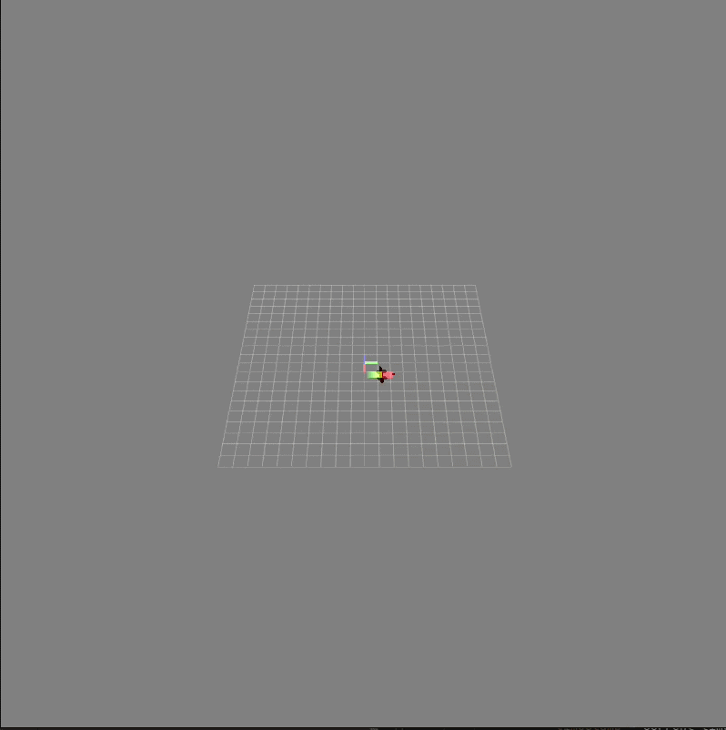
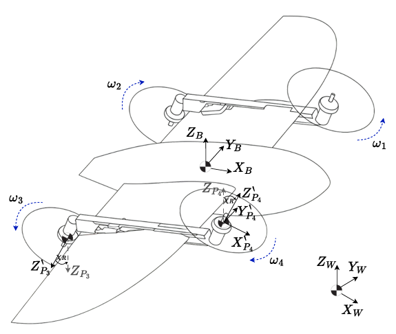

# INDI Control for Hybrid Tilt-Rotor UAVs

**Nonlinear flight dynamics, incremental control and constrained actuator
allocation for a hybrid UAV.** MSc research project at ISAE-SUPAERO/ENAC,
completed in June 2026, with a preliminary elevon extension added in October.

The work combines:

- a six-degree-of-freedom tilt-rotor model with actuator dynamics and a segmented
  ground-anchored tether;
- cascaded Incremental Nonlinear Dynamic Inversion (INDI) guidance and
  stabilization, with weighted least-squares (WLS) rotor/tilt allocation;
- tracking, actuator-effort and sensitivity studies, plus a later extension
  coordinating elevons with the existing allocator.

This is a **documentation-only showcase**: selected figures and academic
deliverables are public; simulator source, tuning files and raw logs are not.

**June RP results:** stable circular tracking up to ~14 m/s | 0.087 m nominal
tethered RMSE | ±15% cable/vehicle sensitivity study | 70% lower simulated RMSE
than PID in the quadrotor benchmark.

## Project Materials

[Full report PDF](docs/report/indi-research-project-report.pdf) |
[Final presentation PPTX](https://github.com/enriquev212/hybrid-tiltrotor-indi-control/releases/download/project-materials-v1/indi-hybrid-uav-defense.pptx)

## Core Idea

INDI is used as an incremental control strategy: instead of relying on exact
cancellation of the full nonlinear plant, the controller corrects commands from
measured or estimated acceleration response and local control effectiveness.
That makes it well suited to a hybrid tilt-rotor whose dynamics change across
hover, transition and forward flight.

The tethered case adds the central difficulty. The cable can go slack or taut,
applies forces and moments through an offset hook point, and introduces periodic
tension disturbances. The project evaluates whether cascaded INDI with
constrained WLS allocation can keep the vehicle on a circular tethered orbit and
how sensitive that behaviour is to cable and vehicle parameters.

  

*Conceptual platform and coordinate-frame illustration. It is not an exact
geometry drawing of the single-wing simulation model or an elevon layout.*

## Key Findings

- In free flight, the controller tracks circular references within a bounded
  envelope, limited by airspeed near 14 m/s and lateral acceleration near
  12 m/s².
- In nominal tethered flight, the UAV tracks the circular orbit accurately while
  the cable behaves as a structured periodic disturbance.
- The cable is not just an added load: it increases thrust demand in hover, but
  can reduce mean thrust in cruise by contributing inward force toward the
  anchor.
- A ±15% cable sensitivity study shows thin robustness margins. Cable stiffness,
  cable length, cable linear density and vehicle mass are stability-critical;
  damping and diameter are weaker in the tested range.
- The quadrotor benchmark supports the INDI implementation path: in simulation
  INDI reduces PID tracking RMSE substantially, while real-flight logs show
  comparable tracking with slightly lower command activity.

## Elevon Extension

The October continuation adds independently actuated left and right elevons:
symmetric deflection provides pitch/lift control, while differential deflection
provides roll control. A speed-dependent surface allocation precedes the existing
rotor/tilt WLS allocator, which handles the remaining demand.

**Status: preliminary, cable-free simulation only.** The integration and a
torque-pulse comparison are documented, including an inherited aerodynamic
coefficient-loading issue that must be corrected before stronger performance
claims. This does not extend the June report's validated scope or demonstrate
wind rejection, energy savings or hybrid flight-test performance.

[See the architecture, comparison and validation limits](docs/elevon-extension.md).

## Quick Links

| Document | Why open it |
|---|---|
| [Research overview](docs/research-overview.md) | Motivation, modelling approach and project context. |
| [Technical summary](docs/technical-summary.md) | Cascaded INDI loops, local effectiveness model and constrained WLS allocation. |
| [Results](docs/results-summary.md) | Envelope limits, tethered RMSE, sensitivity study and the PID-vs-INDI benchmark. |
| [Elevon extension](docs/elevon-extension.md) | Surface mixing, sequential allocation and preliminary cable-free checks. |
| [Contribution summary](docs/contribution-summary.md) | Scope of the collaborative work and what the public version covers. |
| [References](docs/references.md) | Bibliography used in the report. |

## Public Scope

This repository focuses on public technical documentation and selected academic
deliverables. It does not include:

- full simulator source code;
- controller implementation files;
- tuning or configuration files;
- raw simulation logs or datasets;
- third-party reference PDFs.

## Citation

Citation metadata is available in [`CITATION.cff`](CITATION.cff). The repository
can be cited as the public material associated with the research project report:
**Incremental Nonlinear Dynamic Inversion (INDI) Control for Hybrid UAVs**.

## Project Team

Developed by Enrique Valverde Sacristán and José Ricardo Furiati Aguilar as an
MSc Aerospace Engineering research project at ISAE-SUPAERO and ENAC.

Supervisors: Prof. Murat Bronz, Dr. Mauro Villanueva-Aguado and Prof. Yves
Brière.

Maintainer/contact: Enrique Valverde Sacristán
([enriquev212](https://github.com/enriquev212),
[enriquevalverdesacristan@gmail.com](mailto:enriquevalverdesacristan@gmail.com)).

## Notice

No open-source license is currently included. Unless the project owners add a
license or grant permission separately, reuse and redistribution rights should
not be assumed. See [NOTICE.md](NOTICE.md).
