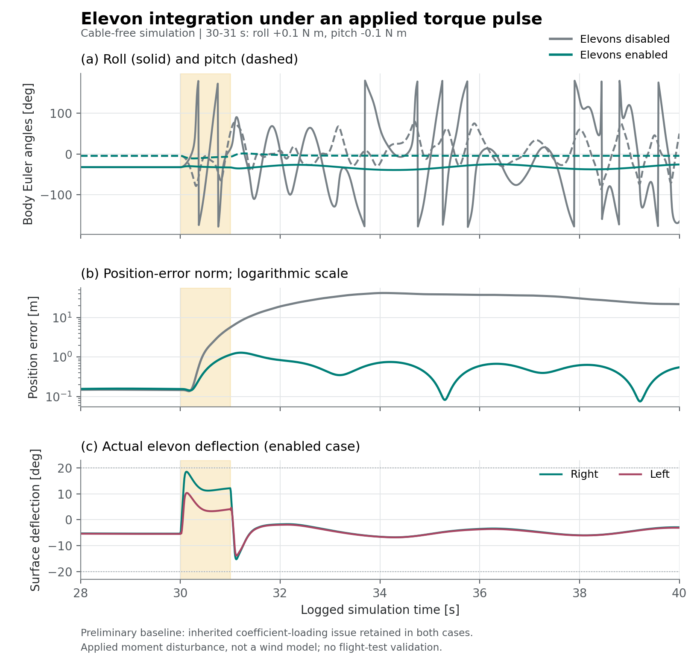

# Elevon Extension

**October 2026 continuation | Preliminary simulation integration | No cable**

This extension adds two aerodynamic control surfaces to the hybrid tilt-rotor
simulation. It is separate from the June 2026 [Research Project report](report/indi-research-project-report.pdf)
and its [reported results](results-summary.md). The public repository documents
the architecture and selected checks, not the implementation or tuning files.

## What Changes

The original vehicle has four rotor-thrust commands and two rotor-tilt commands.
The extension adds independently actuated right and left elevons, with
first-order servo dynamics, deflection limits and rate limits.

Their symmetric and antisymmetric components are:

```math
\delta_e=\frac{\delta_R+\delta_L}{2},\qquad
\delta_a=\frac{\delta_R-\delta_L}{2},
```

```math
\delta_R=\delta_e+\delta_a,\qquad
\delta_L=\delta_e-\delta_a.
```

Here $R$ and $L$ denote the right and left surfaces; positive deflection means
trailing-edge down. The symmetric component changes lift and pitching moment;
the differential component changes rolling moment. These effects are included
in the nonlinear plant and the inner-loop local effectiveness model.

## Allocation Strategy

The controller uses **sequential allocation**, not a joint eight-actuator WLS:

1. The inner INDI loop computes the requested acceleration increment.
2. A speed-dependent blend assigns part of the roll/pitch demand to the elevons.
3. Surface commands are constrained by servo limits, with roll prioritized over
   pitch when both compete for available deflection.
4. The predicted surface contribution, including the associated lift change, is
   subtracted from the demand.
5. The existing six-actuator WLS distributes the residual among the four rotors
   and two tilt commands.

At low speed, the surfaces return toward neutral and the rotor/tilt system
provides control. Their contribution increases in forward flight. The current
controller uses ground-speed magnitude for this blend and its effectiveness
estimate, which is a limitation when wind is present.

## Verification Snapshot

An October 11 review checked the surface model against analytical incremental
roll, pitch and vertical-acceleration calculations for ten fixed-deflection
combinations, including saturation. All ten matched the analytical calculations
to floating-point precision. A separate servo-step check respected the
configured deflection and rate limits. These are **implementation
consistency checks**, not independent aerodynamic validation.



*Two deterministic 60 s reruns of the same October simulation snapshot, with
elevons disabled or enabled. Both use the same circular reference and a 1 s
body-frame torque pulse at 30-31 s: +0.1 N m in roll and -0.1 N m in pitch
(nose-up in the model's forward-left-up convention). The figure shows the
disturbance window; the shaded band marks the pulse and Euler angles use the
model's wrapped representation. Wind and cable forces are disabled. The baseline
coefficient-loading limitation below is deliberately retained in both cases.*

In this particular test, the enabled surfaces provide additional control
authority and retain bounded tracking, whereas the disabled case develops
large attitude excursions and position error. This illustrates the integration
in the tested baseline; it does not establish robustness across aircraft
parameters, winds, flight regimes or tethered conditions.

## Limits and Next Checks

**The inherited baseline must be corrected before treating this comparison as
validated performance.** The configuration uses lower-case rolling, pitching
and yawing moment prefixes, while the aerodynamic model requests upper-case
keys. Eight nonzero stability/damping derivatives consequently load as zero.
This issue affects both comparison cases; it can change their relative behavior
and must not be hidden by presenting the figure as a final robustness result.

Other open checks are:

- Confirm the aerodynamic derivative units, signs and moment-reference point
  against the original AVL model; its source geometry was not available for
  this review.
- Repeat nominal and disturbance cases after correcting coefficient loading,
  then test airspeed-based effectiveness under wind and sideslip.
- Evaluate combined servo constraints and rotor/surface interaction across
  hover, transition and cruise, including tethered flight.
- Validate unmodeled surface drag, adverse yaw and propwash effects before
  drawing power or flight-envelope conclusions.

There is no elevon flight-test validation or demonstrated energy saving here.
The disturbance is an applied torque, **not an atmospheric gust model**. The
original RP report, presentation and GIF remain unchanged; their results are
not retroactively attributed to the elevon extension.
